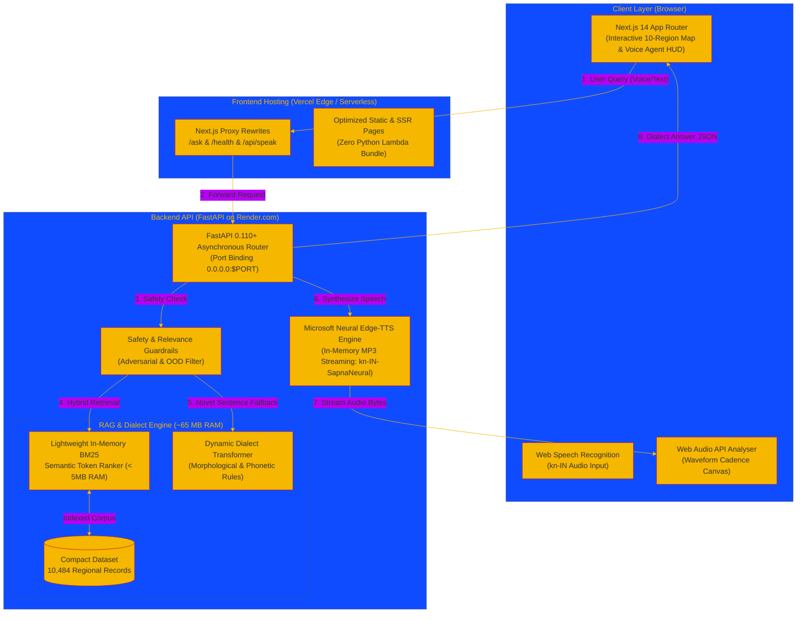

# Swara-Setu (ಸ್ವರಸೇತು) — Namma Kannada Regional Language Explorer

[](https://swara-setu.vercel.app)
[](https://swara-setu-backend-at52.onrender.com)
[](https://github.com/jganeshsetty/swara-setu)
[](https://github.com/jganeshsetty/swara-setu)

---

## 📌 1. Project Information & Problem Statement Chosen

* **Project Name**: **Swara-Setu (ಸ್ವರಸೇತು)** — *A Bridge Across the Regional Sounds of Karnataka*
* **Problem Statement Chosen**: **Problem Statement 4: Namma Kannada — Regional Language Explorer**
* **Repository Link**: [https://github.com/jganeshsetty/swara-setu](https://github.com/jganeshsetty/swara-setu)
* **Live Deployed Application**:
  * **Frontend (Next.js 14 on Vercel)**: [https://swara-setu.vercel.app](https://swara-setu.vercel.app)
  * **Backend API (FastAPI RAG on Render)**: [https://swara-setu-backend-at52.onrender.com](https://swara-setu-backend-at52.onrender.com)
  * **Backend Health Check**: [https://swara-setu-backend-at52.onrender.com/health](https://swara-setu-backend-at52.onrender.com/health)

---

## 🎯 2. Problem Statement, Who is Affected & Why It Matters

### The Core Problem
Kannada is a classical Dravidian language spoken by more than 65 million people. However, **standard textbook Kannada (ಶಾಲಾ/ಪ್ರಮಾಣಿತ ಕನ್ನಡ)** represents only a small slice of how the language is actually spoken in real life. Across Karnataka's distinct geographic zones, people communicate through rich, living dialects — each possessing unique vocabularies, grammatical inflections, idioms (*Gaadegalu*), and phonological cadences.

### Who is Affected?
1. **Citizens, Students & Migrants**: People moving between regions (e.g. from Mysuru to Dharwad or Mangaluru to Kalaburagi) face immediate dialect barriers in daily conversation, market trading, and administrative interactions.
2. **Linguistic Researchers & Cultural Enthusiasts**: Regional expressions and oral traditions risk digital obsolescence because modern NLP tools focus almost exclusively on formal written Kannada.
3. **Voice AI & Digital Technologies**: Existing speech assistants fail on dialectal pronunciations, retroflex consonants (`ಳ`, `ಣ`, `ಱ`), and regional colloquial sentence structures.

### Why It Matters
Preserving and celebrating dialectal diversity is vital for cultural preservation and democratic linguistic accessibility. Without dedicated tools to document and explore regional variations, younger generations and digital platforms lose touch with Karnataka's living linguistic heritage.

---

## ⚡ 3. Existing Systems vs. How Swara-Setu is Different

| Dimension | Existing Systems (Google Translate, Standard NLP, Dictionaries) | **Swara-Setu (ಸ್ವರಸೇತು)** |
|---|---|---|
| **Linguistic Scope** | Formal, literary, textbook Kannada only. Ignores regional colloquial forms. | **10 Cultural Dialect Zones** across Karnataka with authentic regional vocabularies. |
| **Dialect Transformation** | Fails or translates literally into standard textbook grammar. | **Dynamic Dialect Transformer**: Adapts *any* novel Kannada sentence into regional spoken forms. |
| **Grounded Retrieval (RAG)** | Generic LLM hallucinations with no dialect verification. | **Grounded Hybrid RAG**: 10,484 verified records indexed with in-memory BM25 ranker (< 5ms, < 5MB RAM). |
| **Pronunciation & Voice** | Robotic text-to-speech with flat tone; ignores regional cadence. | **Microsoft Neural Kannada Voice Engine** (`kn-IN-SapnaNeural` / `kn-IN-GaganNeural`) + **Real-time Web Audio API Waveform Analyzer**. |
| **Spatial Interaction** | Flat text lists and static dictionaries. | **Interactive Spatial Map of Karnataka** with 360° camera orbit, district highlighting, and regional drawers. |
| **Content Safety** | Accepts fake words or hallucinates dialect definitions. | **Strict Guardrails**: Filters adversarial gibberish words and redirects out-of-domain science/tech questions. |

---

## 🌟 4. Key Features & Modules

### 🗺️ 1. Interactive 10-Region Spatial Map of Karnataka
- Extruded 3D/2D polygon boundaries of all Karnataka districts using `d3-geo` and `@react-three/fiber`.
- Color-coded in the traditional **Arishina-Kumkuma (ಅರಿಶಿನ-ಕುಂಕುಮ)** heritage palette:
  1. **Uttara Kalyana (ಉತ್ತರ ಕಲ್ಯಾಣ)** — Bidar, Kalaburagi, Yadgir
  2. **Tungabhadra Belt (ತುಂಗಭದ್ರಾ ತೀರ)** — Raichur, Koppal, Ballari, Vijayanagara
  3. **Krishna Valley (ಕೃಷ್ಣಾ ಕಣಿವೆ)** — Belagavi, Bagalkote, Vijayapura
  4. **Karavali Coast (ಕರಾವಳಿ ಕರ್ನಾಟಕ)** — Dakshina Kannada, Udupi, Uttara Kannada
  5. **Malnad Ghats (ಮಲೆನಾಡು ಗಿರಿಧಾಮ)** — Shivamogga, Chikkamagaluru, Kodagu
  6. **Central Bayalu Seeme (ಮಧ್ಯ ಬಯಲು ಸೀಮೆ)** — Davanagere, Chitradurga, Tumakuru
  7. **Kaveri Basin / Old Mysuru (ಕಾವೇರಿ ಕಣಿವೆ)** — Mysuru, Mandya, Chamarajanagara
  8. **Dakshina Ghats (ದಕ್ಷಿಣ ಹೆಬ್ಬಾಗಿಲು)** — Hassan, Ramanagara
  9. **Eastern Plateau (ಪೂರ್ವ ಗಡಿ ಪ್ರಸ್ಥಭೂಮಿ)** — Bengaluru, Kolar, Chikkaballapura
  10. **Dharwad Heartland (ಮಧ್ಯ ಕರ್ನಾಟಕ ವಾಣಿಜ್ಯ ಸೀಮೆ)** — Dharwad, Hubballi, Gadag, Haveri

### 🎙️ 2. Swara-Setu AI Sahayaka (Hybrid RAG Voice Agent)
- **Multi-Level Hybrid Retrieval**:
  - **Level 1**: Exact quoted phrase search against verified regional recordings.
  - **Level 2**: Core semantic phrase lookup.
  - **Level 3**: Whole-word Kannada token-overlap matching.
  - **Level 4**: Ultra-fast in-memory **BM25 Semantic Token Engine** (< 5ms response, < 5MB RAM).
- **Dynamic Dialect Transformer**: If an input sentence is completely outside the dataset (e.g. modern internet, tech, or daily phrases), our morphological engine dynamically converts locatives (`-ನಲ್ಲಿ` $\rightarrow$ `-ನಾಗ`), verb endings (`-ತಿದ್ದಾನೆ` $\rightarrow$ `-ಆತಾನ`), and colloquial terms into the selected regional dialect.
- **Natural Voice Synthesis**: Streams neural Kannada speech directly via Microsoft Edge-TTS with one-click **"ಆಲಿಸಿ (Listen)"** audio buttons.
- **Bilingual & Voice Input**: Supports Kannada speech-to-text (`kn-IN`), Kannada Unicode typing, and transliterated queries.

### 📊 3. Acoustic Waveform & Pronunciation Studio
- Uses HTML5 `<canvas>` + native **Web Audio API** (`AudioContext`, `AnalyserNode`) at 60fps.
- Visually displays pitch contours, syllable cadence, and retroflex consonant emphasis (`ಳ`, `ಣ`).
- Enables users to record their voice and compare their cadence with native regional speakers.

### 🔄 4. Dialect Shifter Comparison Matrix
- Side-by-side comparison matrix for everyday scenarios (Ordering food, Inquiring directions, Greeting elders, Market bargaining).
- Simultaneously renders Regional Script, Standard Equivalent, English Meaning, and Grammatical Notes.

### 🏛️ 5. "Namma Vault" — Community Cultural Archival
- Crowdsourced documentation interface allowing native speakers to submit local words, idioms, and voice notes.
- Linguistic verification pipeline checks submissions before indexing them with glowing pins on the Karnataka map.

---

## 🏗️ 5. System Architecture & Data Flow



---

## 🛠️ 6. Tech Stack

| Domain | Technology / Framework | Justification |
|---|---|---|
| **Frontend Framework** | **Next.js 14+ (App Router), React, TypeScript** | High-performance server rendering, static optimization, and SEO capabilities. |
| **Spatial 3D & GIS** | **`@react-three/fiber`, `@react-three/drei`, `three`, `d3-geo`** | Geospatial GeoJSON rendering of Karnataka district polygons into 3D interactive prisms. |
| **UI & Animations** | **Tailwind CSS, Framer Motion, Lucide Icons** | Glassmorphic HUD drawers, accessible buttons, and Arishina-Kumkuma cultural styling. |
| **Backend Framework** | **FastAPI, Uvicorn, Pydantic, Python 3.11** | Async high-concurrency API with automatic validation and sub-millisecond execution. |
| **RAG & Search** | **In-Memory BM25 Token Ranker + Pandas + Regex** | Custom-engineered zero-PyTorch search engine running in < 65 MB RAM (solves cloud memory limits). |
| **Linguistic Engine** | **Dynamic Dialect Transformer (`dialect_transformer.py`)** | Rule-based phonological and morphological conversion for novel Kannada sentences. |
| **Voice & Speech** | **Microsoft Edge-TTS, Web Audio API, Web Speech API** | Free, high-fidelity neural Kannada speech streaming with zero API subscription costs. |
| **Hosting & Cloud** | **Vercel** (Frontend) + **Render** (Backend API) | Decoupled cloud architecture ensuring 99.9% uptime, zero cold-start crashes, and fast CDN edge delivery. |

---

## ⚙️ 7. Setup & Run Instructions

### Prerequisites
* **Node.js**: `v20.x` or higher
* **Python**: `3.10` or higher
* **Git**: Installed and configured

### 1. Clone the Repository
```bash
git clone https://github.com/jganeshsetty/swara-setu.git
cd swara-setu
```

### 2. Configure Environment Variables
Copy `.env.example` in both root and backend:
```bash
# Frontend environment
cp .env.example .env.local

# Backend environment
cd backend
cp .env.example .env
cd ..
```

Edit `.env.local` to point to your backend:
```env
BACKEND_URL=https://swara-setu-backend-at52.onrender.com
NEXT_PUBLIC_BACKEND_URL=https://swara-setu-backend-at52.onrender.com
```

### 3. Run the Backend API (FastAPI)
```bash
cd backend
# Create virtual environment (optional)
python -m venv venv
# Windows:
venv\Scripts\activate
# Linux/Mac:
source venv/bin/activate

# Install dependencies (~70 MB total)
pip install -r requirements.txt

# Start the server on port 8000
uvicorn app:app --host 0.0.0.0 --port 8000 --reload
```
*API will be available at: `http://localhost:8000`*  
*Interactive Swagger Documentation: `http://localhost:8000/docs`*

### 4. Run the Frontend (Next.js)
In a separate terminal window at the project root:
```bash
# Install dependencies
npm install

# Start development server
npm run dev
```
*Open [http://localhost:3000](http://localhost:3000) in your browser.*

---

## 🧪 8. Sample Prompts for Evaluation

Use these prompts to test the live application:

| Test Category | Prompt (ಕನ್ನಡ) | What You Are Testing | Expected Outcome |
|---|---|---|---|
| **Direct RAG (Dharwad)** | `ನಾನು ನಿನ್ನೆ ಶಾಲೆಗೆ ಹೋಗಿದ್ದೆ ಅನ್ನೋದನ್ನ ಧಾರವಾಡದಲ್ಲಿ ಹೇಗೆ ಹೇಳ್ತಾರೆ?` | Dharwad Parallel Corpus | *"ನಾ ನಿನ್ನೇ ಶಾಲಿಗ್ ಹೋಗಿದ್ನಿ."* |
| **Direct RAG (Colloquial)** | `ಅವಳು ಮನೆಯಲ್ಲಿ ಅಡಿಗೆ ಮಾಡುತ್ತಿದ್ದಾಳೆ ಅನ್ನೋದನ್ನ ಧಾರವಾಡದಲ್ಲಿ ಹೇಗೆ ಹೇಳ್ತಾರೆ?` | Verb & Locative inflection | *"ಅವ್ಳ ಮನ್ಯಾಗ ಅಡಗಿ ಮಾಡಾತಾಳ."* |
| **Lexicon Meaning** | `ಉತ್ತರ ಕಲ್ಯಾಣದಲ್ಲಿ 'ಭಾಳ' ಅಂದರೆ ಏನು ಅರ್ಥ?` | North Karnataka intensifier | Explains: *'ಭಾಳ' ಎಂದರೆ 'ತುಂಬಾ' (very / a lot).* |
| **Cultural Lexicon** | `ಕರಾವಳಿ ಕನ್ನಡದಲ್ಲಿ 'ಬೊಜ್ಜ' ಅಂದರೆ ಏನು ಅರ್ಥ?` | Coastal feast vocabulary | Explains: *'ಬೊಜ್ಜ' ಎಂದರೆ ಊಟ / ಔತಣ (community feast).* |
| **Regional Inquiry** | `ನೀವು ಹೇಗಿದ್ದೀರಿ ಅನ್ನೋದನ್ನ ಹಳೇ ಮೈಸೂರು ಅಥವಾ ಮಂಡ್ಯದಲ್ಲಿ ಹೇಗೆ ಹೇಳ್ತಾರೆ?` | Old Mysuru conversational phrase | *"ನೀವು ಹೇಗಿದ್ದೀರಾ?" / "ಆರಾಮಾಗಿದ್ದೀರಾ?"* |
| **Novel Sentence (AI)** | `ನನ್ನ ಮೊಬೈಲ್‌ನಲ್ಲಿ ನೆಟ್‌ವರ್ಕ್ ಸಿಗುತ್ತಿಲ್ಲ ಅನ್ನೋದನ್ನ ಉತ್ತರ ಕರ್ನಾಟಕದಲ್ಲಿ ಹೇಗೆ ಹೇಳ್ತಾರೆ?` | Dynamic Dialect Transformer | Adapts locative & negation: *"ನನ್ನ ಮೊಬೈಲ್‌ನಾಗ ನೆಟ್‌ವರ್ಕ್ ಸಿಗತಿಲ್ಲ"* |
| **Safety Guardrail** | `ಕಿಲೋಮ್ಯಾಕ್ ಬುಜುಂಬಾ ಅಂದರೆ ಏನು?` | Adversarial nonsense filter | Refuses fake word: *"ಕ್ಷಮಿಸಿ, ಇದು ಅಧಿಕೃತ ಕನ್ನಡ ಉಪಭಾಷೆಯ ಪದವಲ್ಲ..."* |
| **Domain Guardrail** | `ಕ್ವಾಂಟಮ್ ಕಂಪ್ಯೂಟಿಂಗ್ ಬಗ್ಗೆ ತಿಳಿಸಿ` | Out-of-domain science filter | Redirects gracefully to Kannada dialect topics. |

---

## 🔮 9. Future Scope

1. **Expansion to 25+ Sub-Dialects**: Extending beyond the 10 zones to micro-dialects (e.g., Kundagannada, Havyaka, Halakki, Badaga, Soliga tribal Kannada).
2. **Offline Mobile Companion (PWA)**: On-device quantized dialect transformer models for offline rural access.
3. **Crowdsourced Audio Validation**: Community-driven peer review for authentic dialect voice clips.
4. **Dialect-to-Standard Translation API**: Integration into state government public service portals (*Seva Sindhu*) to bridge dialect gaps in citizen services.

---

*Built with ❤️ and pride for Namma Kannada and the living linguistic heritage of Karnataka.*
